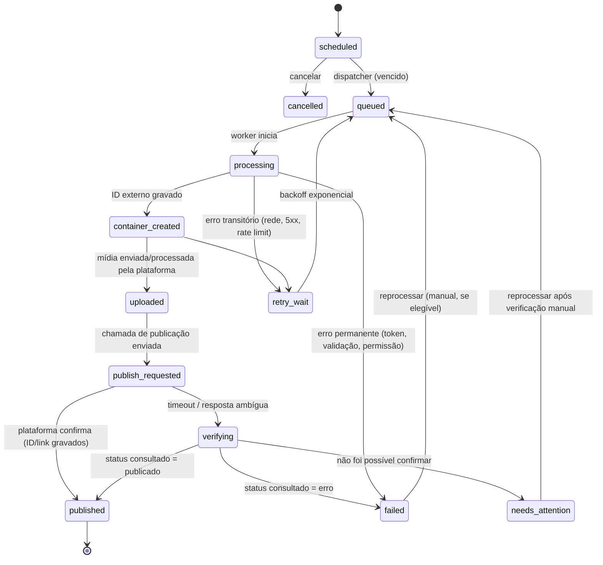
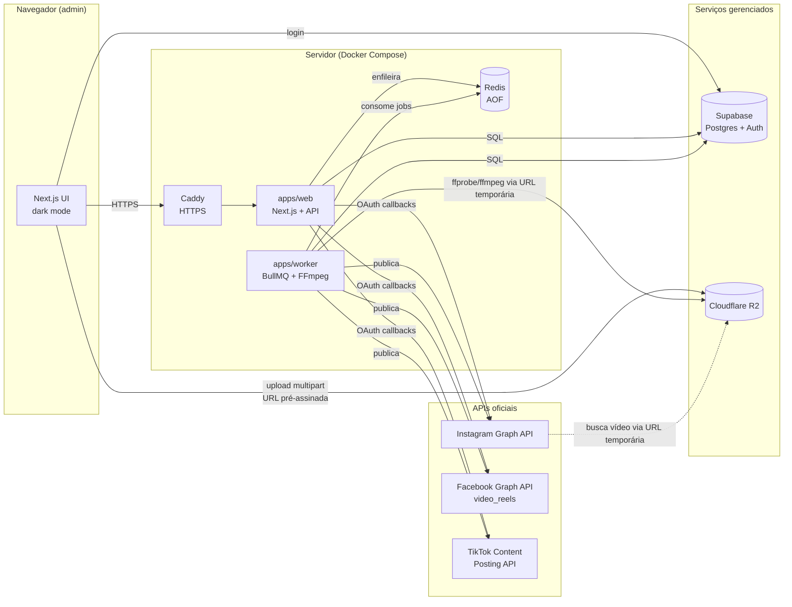
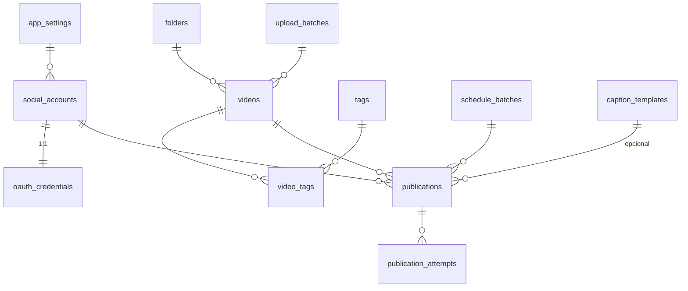

# ReelFlow Personal — Análise Inicial (Fase 0)

> Documento de arquitetura e planejamento. **Nenhuma funcionalidade foi implementada ainda.**
> Aguardando autorização para iniciar a Fase 1.
>
> Data da análise: 2026-11-20 · Fuso de referência: America/Manaus (UTC−4, sem horário de verão)

---

## 0. Diagnóstico do ambiente

| Item | Situação |
|---|---|
| Repositório | `ast1500/Landing-Page`, branch `claude/reelflow-personal-architecture-kr81i7` |
| Conteúdo atual | 1 commit (“Initial commit”) com uma página estática de login (`index.html`, `style.css`, `lava-lamp-animate.svg`). **Nenhum código relacionado ao ReelFlow.** |
| Node.js | v22.23.5 (LTS) ✅ |
| pnpm / npm / yarn | 10.28.0 / 10.9.9 / 1.22.22 ✅ |
| FFmpeg / FFprobe | 6.1.1 ✅ |
| Docker / Compose | Docker 29.10 + Compose v5.7.1 instalados; **daemon não está rodando** neste container (precisa ser iniciado para testar o `docker-compose.yml`) |
| PostgreSQL (local) | psql 16.15 ✅ (útil para testes de integração) |
| Redis (local) | 7.0.15 ✅ (útil para testes de BullMQ) |
| Supabase CLI | não instalado globalmente; disponível via `npx supabase` |
| Recursos | 4 vCPU, 15 GB RAM, disco suficiente |

**Decisão pendente:** o repositório se chama *Landing-Page* e contém uma página não relacionada. Proposta: mover os arquivos atuais para `legacy/landing-page/` (ou removê-los) e usar este repositório como monorepo do ReelFlow — ou criar um repositório dedicado. Ver seção 10.

---

## 1. Arquitetura detalhada

### 1.1 Princípios

1. **PostgreSQL é a fonte da verdade.** Redis/BullMQ são o mecanismo de execução; se o Redis for perdido, o estado é reconstruído a partir do banco.
2. **O navegador nunca publica.** O frontend apenas cria/edita registros e consulta status. Toda publicação é feita pelo worker.
3. **Upload direto do navegador para o R2** (URLs pré-assinadas, multipart). O servidor não trafega os bytes dos vídeos.
4. **Publicação idempotente com máquina de estados.** Cada passo externo (criar contêiner, enviar mídia, publicar) grava seu identificador externo **antes** do passo seguinte. Em caso de dúvida, o sistema **consulta** a plataforma; nunca repete às cegas.
5. **Original imutável.** O arquivo enviado nunca é alterado. Qualquer conversão (opcional e autorizada) gera um arquivo derivado.
6. **Integrações atrás de uma interface comum** (`PlatformPublisher`), com implementação simulada (*mock*) para testes e um *kill switch* global (`PUBLISHING_ENABLED=false` por padrão).

### 1.2 Componentes (mapeamento para os 9 módulos)

| Módulo | Implementação | Onde roda |
|---|---|---|
| 1. Frontend | Next.js (App Router) + React + TypeScript + Tailwind + componentes estilo shadcn/ui | `apps/web` |
| 2. Backend (API) | Route Handlers / Server Actions do Next.js com lógica de domínio em pacotes compartilhados. Sem servidor HTTP extra. | `apps/web` (camada servidor) |
| 3. Banco de dados | Supabase Postgres, acesso via Drizzle ORM (driver `postgres`), migrações SQL em `supabase/migrations` | Supabase Cloud |
| 4. Armazenamento | Cloudflare R2 via API S3 (`@aws-sdk/client-s3` + presigner) | R2 |
| 5. Processamento de vídeo | FFprobe (metadados) + FFmpeg (miniaturas; transcodificação opcional) em jobs BullMQ | `apps/worker` |
| 6. Agendamento | Tabela `publications` + *dispatcher* (job repetitivo a cada 30 s) que move itens vencidos para as filas | `apps/worker` |
| 7. Filas de publicação | BullMQ: `media`, `dispatch`, `publish-instagram`, `publish-facebook`, `publish-tiktok`, `maintenance` | Redis + `apps/worker` |
| 8. Integrações sociais | `packages/integrations` — clientes Meta (Instagram/Facebook) e TikTok, OAuth e publicação | usado por `web` (OAuth) e `worker` (publicação) |
| 9. Monitoramento | Tabelas `publication_attempts` e `audit_log`, logs estruturados (pino, com redação de segredos), painel de histórico e painel de filas protegido | `web` + `worker` |

### 1.3 Por que o “backend” fica dentro do Next.js

O sistema tem um único usuário e pouco tráfego HTTP. Um servidor Express/Fastify separado duplicaria autenticação, validação e deploy sem ganho real. A “API modular” é garantida pela separação em pacotes (`integrations`, `database`, `validation`, `queue`), e o trabalho pesado/longo fica no **worker**, um processo Node independente que continua rodando com o navegador fechado. Se no futuro for necessário separar a API, os pacotes já estão desacoplados.

### 1.4 Fluxos principais

**Upload (até 100 vídeos por lote)**
1. Navegador valida extensão/tamanho/quantidade e cria um `upload_batch` (API).
2. Para cada arquivo, a API cria o registro `videos` (status `uploading`) e devolve URLs pré-assinadas de multipart do R2.
3. O navegador envia as partes direto ao R2, com concorrência limitada (ex.: 3 arquivos × 4 partes), progresso individual e geral, e retomada após interrupção (o `uploadId` e as partes concluídas ficam registrados).
4. Ao concluir, a API finaliza o multipart e enfileira `media:probe`.
5. O worker executa o FFprobe (lendo via URL pré-assinada, sem baixar o arquivo inteiro), verifica a assinatura real do arquivo (*magic bytes*), extrai os metadados, gera a miniatura (FFmpeg) e calcula a compatibilidade com cada plataforma → status `ready` ou `invalid`.

> Limitação física: o **envio** dos arquivos parte do dispositivo do usuário, então a aba precisa ficar aberta até o fim do envio. Depois que o arquivo está no R2, todo o resto (processamento, agendamento, publicação) acontece no servidor.

**Agendamento → publicação**
1. O assistente de agendamento em massa calcula a distribuição **no servidor** (função pura, testável) e mostra uma prévia.
2. Ao confirmar, cria N registros em `publications` (status `scheduled`) numa única transação, respeitando a regra de não duplicidade.
3. O *dispatcher* (a cada 30 s) seleciona `scheduled_at <= now()` com `FOR UPDATE SKIP LOCKED`, marca `queued` e adiciona o job na fila da plataforma com `jobId = publication_id` (deduplicação nativa do BullMQ).
4. O worker da plataforma executa a máquina de estados (seção 1.5) e grava cada tentativa em `publication_attempts`.
5. Reagendar/cancelar só altera o banco; como o job só é criado no vencimento, não sobram jobs “órfãos” atrasados no Redis.

### 1.5 Máquina de estados da publicação



Regras:
- **Nunca** há nova tentativa automática a partir de `publish_requested`; o caminho obrigatório é `verifying`.
- Retentativas automáticas só em erros classificados como transitórios e **antes** do pedido de publicação (máx. configurável, ex.: 5, backoff 1 min → 2 → 4 → 8 → 16).
- Rate limit: o job é reagendado para depois da janela informada pela plataforma (cabeçalhos/códigos de erro), sem consumir tentativa.
- Concorrência: no máximo 1 publicação simultânea **por conta** (lock no Redis com TTL + verificação no banco) e limite global por fila.

---

## 2. Diagrama de funcionamento



---

## 3. Estrutura de diretórios

```
.
├── apps/
│   ├── web/                         # Next.js (UI + API)
│   │   ├── src/app/
│   │   │   ├── (auth)/login/
│   │   │   ├── (app)/               # rotas protegidas
│   │   │   │   ├── dashboard/
│   │   │   │   ├── biblioteca/
│   │   │   │   ├── agendar/         # assistente em massa
│   │   │   │   ├── calendario/
│   │   │   │   ├── contas/
│   │   │   │   ├── legendas/
│   │   │   │   ├── historico/
│   │   │   │   └── configuracoes/
│   │   │   └── api/
│   │   │       ├── uploads/         # presign, complete, abort
│   │   │       ├── oauth/[platform]/{start,callback}/
│   │   │       ├── publications/
│   │   │       └── health/
│   │   ├── src/components/          # ui/ (base), layout/, features/
│   │   ├── src/lib/                 # supabase ssr, auth guard, csrf
│   │   ├── src/middleware.ts        # proteção de rotas
│   │   └── e2e/                     # Playwright
│   └── worker/
│       ├── src/
│       │   ├── queues/              # definição das filas
│       │   ├── processors/          # media, dispatch, publish-*, maintenance
│       │   ├── publishing/          # máquina de estados, classificação de erros
│       │   ├── media/               # wrappers ffprobe/ffmpeg
│       │   └── index.ts             # bootstrap, graceful shutdown, recovery
│       └── test/
├── packages/
│   ├── database/                    # schema Drizzle, cliente, repositórios
│   ├── shared/                      # tipos, constantes, crypto (AES-GCM), storage R2, logger, datas/fuso
│   ├── validation/                  # schemas zod (API, formulários, env)
│   ├── integrations/                # meta/ (instagram, facebook), tiktok/, mock/, interface PlatformPublisher
│   └── queue/                       # nomes de filas, tipos de payload, factories BullMQ
├── supabase/
│   ├── migrations/                  # SQL versionado
│   ├── seed.sql
│   └── config.toml
├── docs/
│   ├── analise-inicial.md           # este documento
│   ├── architecture.md
│   ├── database.md
│   ├── integrations.md
│   ├── deployment.md
│   └── checklist.md                 # progresso por fase
├── docker/
│   ├── web.Dockerfile
│   ├── worker.Dockerfile            # inclui ffmpeg
│   └── Caddyfile
├── docker-compose.yml               # produção: web, worker, redis, caddy
├── docker-compose.dev.yml           # dev: redis (+ supabase local via CLI)
├── .env.example
├── pnpm-workspace.yaml
├── tsconfig.base.json
├── vitest.workspace.ts
└── README.md
```

Em relação à estrutura sugerida, acrescento dois pacotes: **`integrations`** (usado tanto pelo `web` nos callbacks OAuth quanto pelo `worker` na publicação; evita duplicação) e **`queue`** (contrato único de filas/payloads entre `web` e `worker`).

---

## 4. Modelo de banco de dados

Todas as datas em `timestamptz` (UTC); a conversão para America/Manaus é feita na interface. RLS habilitado em todas as tabelas, sem políticas para `anon`/`authenticated` — o acesso a dados é feito apenas pelo servidor (conexão direta/service role), nunca pelo navegador.



### Tabelas

**`app_settings`** (linha única) — `timezone` (default `America/Manaus`), `prevent_duplicate_per_account` (bool, default true), `ai_enabled` (bool, default false), `ai_provider`, `default_publish_settings` (jsonb), `updated_at`.

**`social_accounts`** — `id` uuid, `platform` enum(`instagram`,`facebook`,`tiktok`), `display_name`, `external_id`, `username`, `account_type` (ex.: `ig_business`, `ig_creator`, `fb_page`, `tiktok_creator`), `avatar_url`, `connection_status` enum(`connected`,`expiring`,`expired`,`revoked`,`error`,`disconnected`), `authorization_status` (escopos concedidos vs. exigidos), `scopes` text[], `authenticated_at`, `token_expires_at`, `refresh_expires_at`, `last_checked_at`, `last_error_code`, `last_error_message`, `metadata` jsonb (ex.: página vinculada ao IG), `created_at`, `updated_at`.
- `UNIQUE (platform, external_id)`.
- Trigger: impede mais de **10** contas com status ≠ `disconnected`.

**`oauth_credentials`** — `account_id` (PK/FK), `access_token_enc` bytea, `refresh_token_enc` bytea, `key_version` int, `updated_at`. Criptografia AES-256-GCM na aplicação (nonce + tag embutidos). Tabela sem nenhuma permissão para roles do cliente; nunca serializada para o frontend.

**`oauth_states`** — `state` (PK), `platform`, `code_verifier_enc` (PKCE, quando aplicável), `redirect_after`, `expires_at` (10 min), `used_at`.

**`upload_batches`** — `id`, `total_files`, `completed_files`, `failed_files`, `status`, `created_at`.

**`videos`** — `id`, `upload_batch_id`, `folder_id`, `original_filename`, `display_name`, `storage_key` (original, imutável), `derived_storage_key` (conversão opcional), `thumbnail_key`, `size_bytes`, `mime_type`, `container_format`, `video_codec`, `audio_codec`, `duration_ms`, `width`, `height`, `aspect_ratio` (texto, ex. `9:16`), `fps`, `bitrate`, `rotation`, `checksum_sha256`, `status` enum(`uploading`,`uploaded`,`processing`,`ready`,`invalid`,`failed`,`deleted`), `processing_progress` (0–100), `platform_compatibility` jsonb (por plataforma: ok/avisos/erros), `multipart_upload_id`, `error_message`, `created_at`, `deleted_at` (exclusão lógica).
- Índices: `status`, `created_at`, busca por nome (`pg_trgm` em `display_name`).

**`folders`** — `id`, `name`, `parent_id` (opcional). **`tags`** — `id`, `name` UNIQUE, `color`. **`video_tags`** — PK (`video_id`, `tag_id`).

**`caption_templates`** — `id`, `name`, `body`, `hashtags` text[], `platform` (nullable = todas), `created_at`.

**`schedule_batches`** — `id`, `mode` enum(`uniform`,`custom`,`individual`,`multiplatform`), `params` jsonb (posts/dia, horários, intervalo, data inicial, fuso), `total_publications`, `created_at`.

**`publications`** (núcleo) — `id`, `video_id`, `account_id`, `platform` (desnormalizado para filas/filtros), `schedule_batch_id`, `caption_template_id`, `scheduled_at`, `caption`, `publish_settings` jsonb (ex.: TikTok `privacy_level`, `disable_comment`; IG `share_to_feed`; capa), `status` enum(`draft`,`scheduled`,`queued`,`processing`,`container_created`,`uploaded`,`publish_requested`,`verifying`,`retry_wait`,`published`,`failed`,`needs_attention`,`cancelled`), `attempt_count`, `max_attempts`, `next_attempt_at`, `external_container_id` (IG creation_id / FB video_id / TikTok publish_id), `external_post_id`, `permalink`, `published_at`, `last_error_code`, `last_error_message`, `allow_duplicate` bool, `idempotency_key` UNIQUE, `version` (lock otimista), `created_at`, `updated_at`.
- **Índice único parcial anti-duplicidade:** `(video_id, account_id) WHERE allow_duplicate = false AND status NOT IN ('cancelled','failed')`.
- Índices: `(status, scheduled_at)` para o dispatcher; `(account_id, scheduled_at)`; `(platform, status)`.

**`publication_attempts`** — `id`, `publication_id`, `attempt_no`, `step`, `started_at`, `finished_at`, `outcome` (`success`,`transient_error`,`permanent_error`,`ambiguous`,`rate_limited`), `http_status`, `error_code`, `error_message`, `platform_trace_id`, `response_excerpt` jsonb (sanitizado). **Nunca removido automaticamente.**

**`audit_log`** — `id`, `entity_type`, `entity_id`, `action`, `details` jsonb (sem credenciais), `created_at`.

Detalhes completos (DDL, enums, índices) irão para `docs/database.md` e a primeira migração na Fase 2.

---

## 5. Dependências

Versões exatas serão fixadas na Fase 1 (última estável, com lockfile).

| Área | Pacote | Motivo |
|---|---|---|
| Monorepo | `pnpm` workspaces | Sem Turborepo/Nx inicialmente — desnecessário para 2 apps |
| Linguagem | `typescript`, `tsx` | Execução do worker em dev |
| Web | `next`, `react`, `react-dom`, `tailwindcss` | Stack definida |
| UI | `@radix-ui/*` (via componentes estilo shadcn copiados para o repo), `lucide-react`, `clsx`, `tailwind-merge` | Componentes acessíveis sem biblioteca pesada |
| Formulários | `react-hook-form`, `@hookform/resolvers`, `zod` | Validação única cliente/servidor |
| Dados no cliente | `@tanstack/react-query` | Cache e *polling* de progresso |
| Calendário | `@fullcalendar/react` + `daygrid`, `timegrid`, `interaction` (licença MIT) | Dia/semana/mês e arrastar-e-soltar prontos |
| Gráficos | `recharts` | Gráficos simples do dashboard |
| Datas | `date-fns`, `@date-fns/tz` | Fuso America/Manaus |
| Upload | `@uppy/core` + `@uppy/aws-s3` (headless, UI própria) | Multipart com retomada — evita reimplementar lógica delicada |
| Auth | `@supabase/supabase-js`, `@supabase/ssr` | Supabase Auth com cookies no App Router |
| Banco | `drizzle-orm`, `drizzle-kit`, `postgres` | Tipagem + SQL explícito; transações com `SKIP LOCKED` no worker |
| Storage | `@aws-sdk/client-s3`, `@aws-sdk/s3-request-presigner` | R2 é compatível com S3 |
| Filas | `bullmq`, `ioredis` | Stack definida |
| Mídia | FFmpeg/FFprobe do sistema (instalado na imagem Docker), invocados via `child_process` | Sem wrappers abandonados (ex.: fluent-ffmpeg) |
| Logs | `pino` (com `redact`) | Logs estruturados sem segredos |
| Painel de filas | `@bull-board/api` + adaptador | Inspeção das filas, rota protegida (opcional) |
| HTTP | `fetch` nativo do Node 22 | Sem axios |
| Testes | `vitest`, `@playwright/test`, `msw` | Unitários/integração + E2E + simulação das APIs sociais |
| Qualidade | `eslint`, `prettier` | Padronização |
| IA (opcional) | SDK do provedor escolhido, carregado somente se `AI_ENABLED=true` | Não obrigatório |

---

## 6. Variáveis de ambiente (`.env.example`, sem valores reais)

```bash
# --- App ---
NODE_ENV=development
APP_URL=http://localhost:3000
APP_TIMEZONE=America/Manaus
ADMIN_EMAIL=                       # único e-mail autorizado a entrar
LOG_LEVEL=info

# --- Supabase ---
NEXT_PUBLIC_SUPABASE_URL=
NEXT_PUBLIC_SUPABASE_ANON_KEY=     # chave pública (publishable); seguro no cliente
SUPABASE_SERVICE_ROLE_KEY=         # SOMENTE servidor/worker
DATABASE_URL=                      # pooler (transaction mode) — web
DATABASE_DIRECT_URL=               # conexão direta — worker e migrações

# --- Redis ---
REDIS_URL=redis://redis:6379

# --- Cloudflare R2 ---
R2_ACCOUNT_ID=
R2_ACCESS_KEY_ID=
R2_SECRET_ACCESS_KEY=
R2_BUCKET=reelflow-media
R2_PRESIGN_UPLOAD_TTL_SECONDS=3600
R2_PRESIGN_DOWNLOAD_TTL_SECONDS=7200

# --- Criptografia de tokens ---
TOKEN_ENCRYPTION_KEY=              # 32 bytes em base64 (openssl rand -base64 32)
TOKEN_ENCRYPTION_KEY_VERSION=1

# --- Meta (Instagram + Facebook) ---
META_APP_ID=
META_APP_SECRET=
META_GRAPH_API_VERSION=            # fixar versão (ex.: vXX.0) conforme documentação vigente
META_OAUTH_REDIRECT_URI=${APP_URL}/api/oauth/meta/callback
INSTAGRAM_APP_ID=                  # apenas se usar "Instagram API with Instagram Login"
INSTAGRAM_APP_SECRET=

# --- TikTok ---
TIKTOK_CLIENT_KEY=
TIKTOK_CLIENT_SECRET=
TIKTOK_OAUTH_REDIRECT_URI=${APP_URL}/api/oauth/tiktok/callback

# --- Segurança de publicação ---
PUBLISHING_ENABLED=false           # kill switch global
PUBLISH_MODE=mock                  # mock | live
INSTAGRAM_PUBLISHING_ENABLED=false
FACEBOOK_PUBLISHING_ENABLED=false
TIKTOK_PUBLISHING_ENABLED=false

# --- Limites ---
MAX_BATCH_FILES=100
MAX_SOCIAL_ACCOUNTS=10
MAX_UPLOAD_SIZE_MB=1024
ALLOWED_VIDEO_EXTENSIONS=mp4,mov

# --- Worker ---
WORKER_MEDIA_CONCURRENCY=2
WORKER_PUBLISH_CONCURRENCY=3
DISPATCH_INTERVAL_SECONDS=30
PUBLISH_MAX_ATTEMPTS=5
FFMPEG_PATH=ffmpeg
FFPROBE_PATH=ffprobe

# --- IA (opcional) ---
AI_ENABLED=false
AI_PROVIDER=
AI_API_KEY=
AI_MODEL=

# --- Monitoramento (opcional) ---
BULL_BOARD_ENABLED=false
SENTRY_DSN=
```

As variáveis são validadas com zod na inicialização (`packages/validation/env.ts`): o app/worker não sobe com configuração inválida, e as variáveis secretas nunca recebem prefixo `NEXT_PUBLIC_`.

---

## 7. Custos estimados (mensais)

Valores aproximados com base em preços públicos conhecidos; confirmar no momento da contratação.

| Item | Opção econômica | Opção recomendada |
|---|---|---|
| Servidor (web + worker + Redis + Caddy) | VPS 2 vCPU / 4 GB ≈ US$ 5–8 | VPS 4 vCPU / 8 GB ≈ US$ 10–20 (FFmpeg simultâneo com folga) |
| Supabase | Free: US$ 0 (500 MB de banco; **projeto pode ser pausado por inatividade**; sem backups diários) | Pro: US$ 25 (sem pausa, backups diários) |
| Cloudflare R2 | ~US$ 0,015/GB‑mês, 10 GB grátis, **sem custo de egress**. 100 GB ≈ US$ 1,35 | idem |
| Operações R2 | desprezível nesse volume | idem |
| Domínio + TLS | ~US$ 1/mês (TLS grátis via Caddy/Let’s Encrypt) | idem |
| APIs Meta / TikTok | gratuitas | gratuitas |
| IA de legendas (opcional) | US$ 0 (desativada) | centavos a poucos dólares, conforme uso |
| **Total** | **≈ US$ 7–12/mês** | **≈ US$ 37–50/mês** |

Referência de armazenamento: 100 vídeos × ~50 MB ≈ 5 GB por lote. Recomendo política configurável de retenção (ex.: apagar originais publicados em todas as contas após X dias, apenas com confirmação).

---

## 8. Riscos técnicos

| # | Risco | Impacto | Mitigação |
|---|---|---|---|
| 1 | **Auditoria do TikTok.** Apps não auditados na Content Posting API só publicam com visibilidade privada (`SELF_ONLY`) e com restrições de usuários. Ferramentas de uso pessoal/interno podem ter a auditoria negada. | Alto | Construir o módulo completo e testável; liberar publicação pública somente após aprovação. Plano B oficial: modo “upload para rascunho/inbox” (escopo `video.upload`), em que a pessoa finaliza a postagem no app do TikTok. Confirmar requisitos atuais na Fase 8. |
| 2 | **Diretrizes de UX do TikTok** (exibir dados do criador, escolha explícita de privacidade sem valor padrão, consentimento, consulta `creator_info` antes de postar) podem conflitar com agendamento em massa “cego”. | Alto | Assistente exige escolha explícita de privacidade e opções por conta/lote; o worker reconsulta `creator_info` no momento da publicação e falha com segurança se algo mudou (ex.: duração máxima). |
| 3 | **Revisão de app da Meta / modo de desenvolvimento.** Permissões de publicação exigem revisão para uso geral; para uso apenas por contas com função no app (admin/dev/tester) o modo de desenvolvimento pode bastar. Pode haver exigência de verificação de empresa. | Médio | Validar na Fase 6 se o uso pessoal funciona em modo dev com as contas como testers; documentar o passo a passo em `docs/integrations.md`. |
| 4 | **Contas elegíveis.** Instagram exige conta profissional (Business/Creator); Facebook Reels exige **Página**. Perfis pessoais não são suportados. | Médio | Validar o tipo de conta ao conectar e exibir mensagem clara. |
| 5 | **Especificações de vídeo diferentes por plataforma** (duração, proporção, codec, tamanho; Facebook Reels tem limite de duração bem menor que Instagram/TikTok). | Médio | Matriz de compatibilidade por plataforma calculada no processamento, com os limites lidos da documentação oficial vigente em cada fase; bloqueio antes do agendamento. Conversão apenas opcional e autorizada, gerando arquivo derivado. |
| 6 | **Resultado ambíguo** (timeout após pedido de publicação) → risco de post duplicado. | Alto | Máquina de estados + estado `verifying` + consulta de status (IG: `status_code` do contêiner; FB: fases de status do vídeo; TikTok: `status/fetch`). Sem confirmação → `needs_attention`, nunca repetição automática. |
| 7 | **Expiração de tokens** (tokens de usuário Meta de longa duração ≈ 60 dias; access token TikTok curto com refresh token). Troca de senha invalida tokens. | Médio | Job `maintenance` diário renova tokens, marca `expiring` com antecedência e alerta no dashboard; publicação falha como erro permanente “reautorizar”. |
| 8 | **Limites de taxa e cotas** (ex.: limite de posts via API por 24 h no Instagram, consultável em `content_publishing_limit`; limites por usuário/minuto e por dia no TikTok). | Médio | Checagem de cota antes de publicar, *limiter* por fila, lock por conta e reagendamento automático em 429 sem gastar tentativa. A distribuição em massa avisa quando o plano excede cotas conhecidas. |
| 9 | **URL pré-assinada expirar** antes de a Meta/TikTok buscar o vídeo. | Baixo | Gerar a URL no momento da publicação, com TTL de 1–2 h. |
| 10 | **Supabase Free pausado** por inatividade / sem backup. | Médio | Plano Pro em produção, ou backup diário via `pg_dump` para o R2. |
| 11 | **Perda do Redis.** | Baixo | AOF ativado; banco é a fonte da verdade; job de recuperação na inicialização do worker re-enfileira itens `queued`/`retry_wait` e coloca `processing`/`publish_requested` em `verifying`. |
| 12 | **Políticas das plataformas sobre conteúdo repetido / comportamento automatizado.** Publicar o mesmo vídeo em muitas contas pode ser tratado como spam. | Médio | Prevenção de duplicidade ativa por padrão, espaçamento mínimo configurável, legendas por conta. Decisão de uso é do administrador. |
| 13 | **Mudanças de versão das APIs** (Graph API é versionada e versões antigas são descontinuadas). | Baixo | Versão fixada em variável de ambiente; testes com mocks baseados em respostas documentadas. |
| 14 | **Uploads maliciosos** (arquivo disfarçado, ffmpeg com entrada hostil). | Médio | Validação de extensão + MIME + *magic bytes* + ffprobe; FFmpeg executado sem shell, com timeout e limites de recursos, em container sem privilégios; protocolos do FFmpeg restritos (`-protocol_whitelist`). |

> Os nomes de endpoints, permissões e limites citados acima vêm da documentação oficial conhecida e **serão reconferidos na documentação vigente no início de cada fase de integração** (6, 7 e 8), antes de qualquer código. Nenhuma resposta de API será inventada: os mocks serão construídos a partir dos exemplos da documentação.

---

## 9. Plano de desenvolvimento

Cada fase termina com: testes passando, `docs/checklist.md` atualizado, decisões registradas e commit na branch. Só avanço com sua autorização.

### Fase 1 — Estrutura inicial
- Monorepo pnpm (`apps/web`, `apps/worker`, `packages/*`), TypeScript estrito, ESLint/Prettier, Vitest configurado.
- Next.js base com Tailwind e tokens da paleta (#080B12, #111827, #2563EB, #22D3EE, #F8FAFC, #94A3B8), layout com sidebar e páginas vazias.
- Worker base (conexão Redis, fila de teste, *graceful shutdown*, health check).
- Validação de ambiente com zod; `.env.example`; `docker-compose.yml` + Dockerfiles (worker com FFmpeg); Caddyfile.
- Documentação: README (instalação), `architecture.md`, `deployment.md` iniciais, `checklist.md`.
- Destino dos arquivos atuais do repositório (conforme sua decisão).
- **Critério de aceite:** `pnpm install && pnpm build && pnpm lint && pnpm test` passam; `docker compose config` válido; web e worker sobem localmente.

### Fase 2 — Banco, autenticação e frontend
- Schema Drizzle + migração SQL inicial em `supabase/migrations`, RLS, trigger de limite de 10 contas, índice anti-duplicidade.
- Supabase Auth (cadastro desativado, apenas `ADMIN_EMAIL`, MFA TOTP recomendado), middleware de rotas protegidas, proteção CSRF (verificação de `Origin` + cookies `SameSite`) e *rate limit* nos endpoints.
- Módulo de criptografia de tokens (AES-256-GCM) com testes.
- Shell da interface: sidebar, dashboard com dados reais (zerados), skeletons e estados vazios.
- **Testes:** migrações aplicadas em Postgres local; acesso negado sem login (Playwright); criptografia ida/volta.

### Fase 3 — Biblioteca e upload
- Upload multipart direto ao R2 (até 100 arquivos), progresso individual/geral, retomada, cancelamento.
- Worker de mídia: ffprobe, *magic bytes*, miniatura, matriz de compatibilidade, progresso.
- Biblioteca: grade/lista, busca, filtros, ordenação, seleção múltipla, exclusão em massa (lógica), pastas e etiquetas, visualização individual.
- **Testes:** lote de 100 arquivos (simulado com arquivos pequenos), upload interrompido e retomado, arquivo inválido/disfarçado, processamento simultâneo.

### Fase 4 — Calendário e agendamento
- Algoritmo de distribuição (uniforme, personalizado, individual, multiplataforma) como função pura, com prévia.
- Assistente de agendamento em massa; regra de não duplicidade com liberação explícita.
- Editor de legendas (por plataforma/conta, modelos, hashtags, emojis, CTA).
- Calendário dia/semana/mês, filtros, arrastar-e-soltar, edição em massa, reagendar, cancelar.
- **Testes:** 100 vídeos × 10 contas, horários diferentes, fuso Manaus ↔ UTC, duplicidade bloqueada.

### Fase 5 — Filas e workers
- Dispatcher, filas por plataforma, máquina de estados, classificação de erros, backoff, lock por conta, limiter, recuperação após reinício, painel de filas.
- `MockPublisher` configurável (sucesso, erro transitório, erro permanente, timeout ambíguo, 429, token expirado).
- **Testes:** reinício do worker no meio do job, perda de conexão, rate limit, prevenção de duplicidade, recuperação de tarefas — tudo com o mock.

### Fase 6 — Instagram
- Reconferir documentação; OAuth Meta; listagem/seleção de contas profissionais; publicação de Reels (contêiner → acompanhamento de status → publicação → captura de ID/permalink); consulta de cota; erros.
- Testes com MSW baseados nos exemplos oficiais; publicação real **somente** com sua autorização explícita e conta de teste.

### Fase 7 — Facebook
- Seleção de Páginas e Page Access Tokens; fluxo oficial de Reels em Páginas (início do upload → envio → finalização → consulta de status); erros. Mesma política de testes.

### Fase 8 — TikTok
- OAuth, verificação de escopos, `creator_info`, envio do vídeo, publicação direta quando autorizada (ou modo rascunho), consulta de status, conformidade com as diretrizes de UX. Publicação pública condicionada à auditoria.

### Fase 9 — Monitoramento e relatórios
- Histórico com filtros/busca, detalhe de tentativas, reprocessamento de itens elegíveis, gráficos por plataforma/status, alertas de token e falhas, backup do banco.
- Integração opcional de IA para legendas (desativável).

### Fase 10 — Testes finais e implantação
- Bateria completa (seção 19 do escopo), testes E2E dos fluxos principais, revisão de segurança, ajuste de performance.
- Deploy na VPS com Docker Compose, HTTPS, guia em `docs/deployment.md`, procedimento de backup/restauração.

---

## 10. Decisões que preciso de você antes da Fase 1

1. **Repositório:** usar este (`Landing-Page`) movendo a página atual para `legacy/` — ou removê-la — ou criar um repositório dedicado?
2. **Hospedagem:** VPS única com Docker Compose (recomendado, mais barato e simples para o worker) — ou outra preferência?
3. **Supabase:** Free durante o desenvolvimento e Pro em produção (recomendado)?
4. **Login Meta:** usar **Facebook Login for Business** como fluxo principal (cobre Instagram vinculado a Página + Páginas do Facebook com um único app), com “Instagram Login” como alternativa para contas IG sem Página?
5. **TikTok:** você já possui (ou pretende criar) um app no TikTok for Developers? Aceita o modo rascunho/inbox como alternativa enquanto a auditoria não sai?
